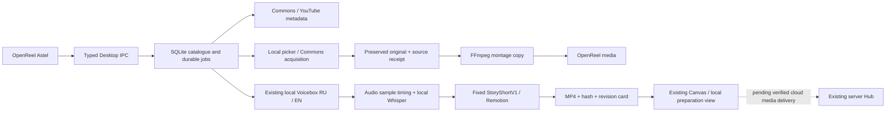

# Astel: материалы → новая история → согласование

Проверка 28 октября 2026. Ветка `integration/astel-media-canvas-stack`.

На Mac установлена новая панель **OpenReel Astel → AI Generate → Материалы и истории**. Она работает с постоянной локальной библиотекой и заданиями, а не требует править код для каждого сценария. Существующая «Сборка ролика» с принятым Amazon 3D остаётся отдельной рабочей кнопкой.

## Как пользоваться

1. Открой проект OpenReel. В «Библиотеке» введи тему и выбери Commons, YouTube или оба источника. Commons возвращает файлы с данными об авторе и лицензии; YouTube — ссылки для исследования. Наличие результата не означает разрешение на его использование.
2. Нажми «Получить файл» у доступного материала либо «Добавить свой файл…». Оригинал сохраняется отдельно; FFmpeg подготавливает монтажную копию. «Добавить в медиа проекта» переносит её в открытый проект.
3. Отметь до 12 файлов. В «Новой истории» введи название и сценарий. Пустая строка разделяет сцены. Выбери прежний голос Олега RU/B или EN и нажми «Собрать новый черновик».
4. Локальный Voicebox озвучит каждый абзац; реальные аудиосэмплы задают границы сцен. Локальный Whisper создаст черновые субтитры. Фиксированный Remotion-шаблон соберёт вертикальный H.264/AAC MP4. Выбранные материалы используются по порядку с повторением; смысловой подбор и автоматический фактчекинг здесь не выполняются.
5. В «Для Canvas» можно просмотреть ролик, сохранить MP4, явно добавить его на таймлайн исходного проекта, экспортировать карточку JSON или начать новую версию сценария. Карточка содержит сценарий, источники, голос, субтитры, revision и SHA-256. Новая кнопка «Открыть Canvas на Mac» включена в feature patch; фактическая проверка установленной кнопки отмечается отдельно в validation JSON.
6. В «Темах» можно запустить до 100 тем. Это очередь поиска метаданных: она не скачивает и не публикует сотню видео автоматически. Дубликаты тем и source IDs убираются; завершённые темы не повторяются при восстановлении.

Подготовка текста и выбор кадров остаются редакторскими действиями. Это рабочий первый универсальный шаблон, а не обещание художественного монтажа любой темы. Субтитры, произношение и соответствие кадров сценарию требуют просмотра.

## Что подключено, а что осталось

| Звено | Фактическое состояние |
|---|---|
| Поиск и постоянный каталог | Установлены; живой Commons search и получение файла проверены |
| Собственные файлы → FFmpeg → OpenReel | Реализованы; оригиналы не перезаписываются |
| Новый сценарий → существующий Voicebox → ASR → Remotion → MP4 | Выполнен полный тест новой истории, 41.024 секунды |
| Просмотр/сохранение/импорт в OpenReel | Native UI; подробные результаты в validation JSON |
| Версии и карточка Canvas | Реализованы локально; устаревший parent/digest отклоняется |
| Существующий Lazy Distribution Canvas | Локальная копия подключена к реальным черновикам: `http://127.0.0.1:17531/`. Видеоплеер, точная версия и замечание после restart проверены |
| Hub adapter | Чистая подготовка `PlanInput`, только simulation; проверен против текущего JS-контракта существующего Hub |
| Облачное MP4 preview / delivery | Не подключено; локальные пути и blob URL не выдаются за доступные серверному исполнителю |
| Автоматическое согласование/публикация | Не включались; действующий Hub остаётся единственным исполнителем доставки |
| Масштабирование | Durable metadata batches; один тяжёлый worker. 100 полнометражных сборок и 24/7 сервис не сертифицированы |

## Архитектура и сохранение данных



Private home: `~/.local/share/astel-media-workspace/`. `catalogue.sqlite` хранит кандидатов, наблюдения, результаты поисков, assets, jobs и версии истории. `assets/<uuid>/` содержит неизменный оригинал, receipt, подготовленную копию и provenance. `jobs/<uuid>/` содержит props, narration, реальные ASR timestamps, sources, private log, MP4 и render receipt. Исходные записи голоса и bindings остаются в прежнем приватном Voicebox home.

## Подключение существующего Canvas

Владелец передал `Lazy_Distribution_Canvas_2026-10-27.html` и `Lazy_Distribution_Canvas_Integration_2026-10-27.zip`. Они сохранены приватно в `canvas/` runtime; исходные файлы не изменены. HTML SHA-256: `89c0152e696fed0e836029d5c64fe5d63b0afa85e7bf7ac93751a64a53d20ada`. ZIP SHA-256: `cca3c19768f91571d628f304c46983af41e69383a040fd15233b351d4dd6d018`.

Аудит пакета подтвердил: полный HTML по умолчанию показывает демо. Его `distribution-core` уже читает Hub через существующий Telegram BFF с owner auth; это не разрешение считать демо реальной очередью. Серверный controller защищает частный документ, а package installer требует отдельной согласованной рабочей копии Telegram backend. В этот increment пакет не применялся к чужому checkout и не развёртывался в production.

Новый адаптер добавляет раздел **«Черновики с Mac»** в ту же навигацию Canvas. Источник данных — существующая SQLite-библиотека подготовки, а не отдельная очередь публикаций. Он показывает MP4 точной revision, сценарий, sources/license, hash и реальные jobs. «Вернуть на правку» сохраняет заметку к `story_id + digest`; «Принять черновик» — только редакторское решение. Оба действия возвращают `publication_approved=false, submitted=false`. Повтор UUID идемпотентен; конфликтующий payload или новая версия отклоняют устаревшее решение. Агент в UI тестировал только замечание к отдельному QA-ролику, не принимал материал за владельца.

Служба `us.astel.media-workspace.canvas` — пользовательский LaunchAgent, слушает только `127.0.0.1:17531`. Owner-local session cookie — HttpOnly / SameSite=Strict, Host/Origin и cross-site requests проверяются; UI не получает Hub credentials. MP4 endpoint проверяет SHA-256 и поддерживает Range/seek. CSP закрывает iframe embedding; поля источников/сценария вставляются через textContent. Нет approve/schedule/publish/Hub proxy endpoints. Служба Canvas поднимается после пользовательского входа; это не boot recovery всех render jobs и не сервер в облаке.

Целый исторический HTML, ZIP, скриншоты внутренних разделов, токены и голосовые исходники **не копируются в публичный GitHub**. В repo находятся только новый собственный adapter JS/CSS/Python и SHA-контрольные точки. Исходные storage keys/данные Canvas не переписываются; browser localStorage другого origin автоматически сюда не переносится. Старые разделы сохраняют исторический статус снимка. Раздел Hub в локальной копии явно подписан учебным; реальный Telegram BFF остаётся отдельным действующим подключением.

Задания: `queued → running → ready | failed | cancelled`. UUID повторяет исходный запрос; конфликтующее содержимое с тем же UUID отвергается. Detached worker продолжает работу при закрытии OpenReel на бодрствующем Mac. При повторном открытии панель возобновляет незавершённые задания. Это не launchd-автозапуск после reboot и не продолжение с конкретного видеокадра. Завершённый render receipt позволяет повторно принять результат без новой озвучки; hash mismatch останавливает восстановление.

Тяжёлая работа сериализована глобальным lock; отмена сохраняется на диске. Установщик отказывает, пока worker держит lock. Получение файла использует staging и атомарную замену монтажной копии; повторная нормализация использует уже сохранённый оригинал. Ограничения: входной файл 100 MiB, каталог media до 2 GiB, свободный резерв 8 GiB; новый сценарий до 3000 символов / 12 абзацев. Лимит каталога не ограничивает суммарный объём MP4 в `jobs/`; регулярная политика архивации ещё нужна перед массовыми сборками.

Renderer не принимает JSX, shell-команды или произвольный entry point из UI. Native picker является отдельным IPC. Desktop повторно проверяет realpath, размер и SHA-256 возвращаемого файла. Автоматический импорт нового ролика проверяет исходный project ID и использует прежний транзакционный timeline adapter с Undo/Redo. Результат — один готовый MP4; редактируемые Remotion-сцены не превращаются автоматически в отдельные клипы OpenReel.

## Migration map

| Компонент | Решение | Результат |
|---|---|---|
| OpenReel editor/project/media/Undo | KEEP | Главный Mac UI и ручной монтаж |
| Astel Voicebox RU/EN и reference recordings | KEEP | Прежние bindings и модели; новая история вызывает существующий coordinator |
| Принятый Amazon / Three.js / Remotion | KEEP | Исходники и замороженный пакет не изменены |
| AstelFam/OLEH_STYLE/Emil и старый AutoEditor | KEEP | Сохранены; этот шаблон не заявляет их автоматическое применение |
| Ручной per-story terminal orchestration | PORT | Native форма → постоянные jobs → общий renderer |
| Временные поисковые подборки | PORT | SQLite, canonical source IDs, provenance и acquisition receipts |
| Canvas shell / защищённый Hub reader | KEEP + PORT | Тот же Canvas дополнен локальной подготовкой; private snapshot остаётся вне Git |
| Доставка и календарь публикаций | KEEP EXISTING HUB | Новый scheduler/второй publisher не создаётся |
| OpenCut и старые панели | DEPRECATE LATER | Сохраняются до успешного пользовательского A/B |
| Kevin / Windows worker | PORT LATER | Stage 2; Mac работает самостоятельно |

## Mac setup / replay

Нужны Apple Silicon Mac, Node 22+, Python 3.11+, Homebrew FFmpeg/ffprobe, уже установленный Voicebox с согласованными RU/EN bindings и прежний локальный Remotion runtime из [STORY_ASSEMBLY.md](STORY_ASSEMBLY.md). Это инкрементальная установка поверх работающей базы, не независимый bootstrap пустого Mac.

```bash
python3 scripts/setup_media_workspace_mac.py --node /absolute/path/to/node
python3 scripts/setup_media_workspace_mac.py --node /absolute/path/to/node \
  --canvas-html /absolute/path/to/Lazy_Distribution_Canvas_2026-10-27.html \
  --canvas-package /absolute/path/to/Lazy_Distribution_Canvas_Integration_2026-10-27.zip \
  --start-canvas
python3 scripts/install_openreel_voicebox_mac.py \
  --with-media-workspace --node /absolute/path/to/node --pnpm /absolute/path/to/pnpm
```

Установщик приложения отказывается перезаписывать существующий `~/Applications/OpenReel Astel.app`: сначала завершить приложение и сохранить его в backup. Он собирает pinned upstream `c9340465…` с cumulative patch `integration/media-workspace/0001-openreel-astel-workspace.patch`. Старые cumulative patches остаются для воспроизведения прежних стадий. Upstream MIT и bundled notices сохраняются. Настройка workspace повторно использует уже установленный pinned renderer/browser; не ссылается на исходники в Documents/Codex cache. Установщик Voicebox при `--with-media-workspace` не переустанавливает замороженный Amazon runtime, если он уже есть.

Откат приложения: завершить Astel, переместить новый candidate в отдельную папку и вернуть `~/.local/share/astel-openreel-voicebox/builds/before-media-workspace-20261028/OpenReel Astel.app` в `~/Applications/`. Каталог библиотеки и прежние проекты при этом сохраняются. `/Applications/OpenReel.app` не заменялся.

## Следующие MCP / tool configuration steps

1. Локальный Canvas уже читает реальные файлы. Для server-facing версии применить прочитанный package к отдельной согласованной review-копии существующего Telegram BFF и пройти его owner auth. Исторический полный HTML не размещать в public/.
2. Подключить проверенную доставку именно этих MP4 bytes: HTTPS origin allowlist, доступ сервера, hash/size/type, срок доступности и preview. Не помещать Hub token или private voice reference в HTML.
3. Связать карточку `story root + revision + digest` с backend Hub plan. Правка ролика, текста, аккаунта или времени требует новой согласуемой версии. Script review и publication approval остаются разными решениями.
4. Проверить через существующий Hub preview → simulation draft → readback в настоящем Canvas → отказ stale revision. Согласование и live scheduling принадлежат пользователю и Hub; в этом инкременте их не вызывали.
5. После native UI acceptance добавить ограниченные workspace MCP tools `list/search/acquire/story/status/cancel/card`; существующий Desktop MCP не получает их автоматически от добавления IPC.
6. До масштабных рендеров добавить архив/retention jobs, bounded backlog, boot recovery и отдельную сертификацию Stage 2 Kevin. Не запускать 100 полных историй на Mac с текущим свободным диском.

Полностью закрытый cloud loop сейчас не заявляется: недостающие реальные подключения перечислены выше. Локальный путь материал → новый сценарий → голос → MP4 уже выполнен; существующая production publishing конфигурация не изменялась.
