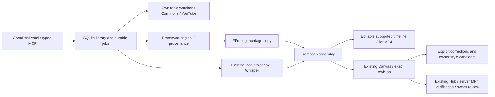

# Astel: материалы → история → OpenReel → Canvas

Проверено 28 октября 2026 (ночные проверки до 29 октября UTC). Ветка `integration/astel-media-canvas-stack`. Точный статус восьми пунктов: [IMPLEMENTATION_1_TO_8.md](IMPLEMENTATION_1_TO_8.md); результаты: [STACK_VALIDATION_2026-10-28.json](STACK_VALIDATION_2026-10-28.json). Более ранние validation JSON сохраняют свидетельства предыдущих этапов.

Установлено `~/Applications/OpenReel Astel.app`. В production развёрнуты согласованные обновления существующих Hub и Telegram Canvas. Сервер загрузил весь тестовый MP4 и сверил хеш; точный simulation-план находится в `NEEDS_APPROVAL`, попыток доставки 0. Платное планирование выключено и на Mac, и на сервере. Голосовые профили, принятый Amazon-пилот, оригинальный OpenReel/OpenCut и publishing configuration сохранены.

## Использование

1. В открытом проекте: **AI Generate → Материалы и истории → Библиотека**. Найти Commons/YouTube, получить доступный файл или добавить свой. RAW сохраняется отдельно, FFmpeg готовит монтажную копию. YouTube-результат является исследовательской ссылкой; наличие результата не даёт разрешения на использование.
2. Выбрать до 12 файлов. В **Новой истории** вставить текст; пустая строка разделяет сцены. Выбрать существующий голос Олега RU/B или EN. Локальный Voicebox и Whisper дают озвучку и реальные таймкоды, Remotion — вертикальный MP4. Ручной сценарий использует файлы по порядку с повторением.
3. **Сценарий** — отдельная форма предложения с фактами/ссылками, наблюдаемыми диапазонами кадров и редактируемой привязкой сцен. Она готова в коде, но платная генерация намеренно отключена. Включённый вариант использует предоставленные человеком факты и shot evidence; сам факт-поиск и семантический просмотр кадров ещё не реализованы. Плановая история использует явные asset/time-range bindings, а не циклический подбор.
4. В **Для Canvas** просмотреть MP4, сохранить файл, добавить готовый MP4 или **редактируемую сборку** в исходный проект. Во втором варианте создаются отдельные дорожки сцен, речи, заголовков и субтитров; поддерживается простое движение изображений. Весь импорт отменяется одним Undo, повтор не дублирует его. Это перенос поддержанных элементов, визуальная идентичность Remotion/Three.js не обещается.
5. **Открыть Canvas на Mac** открывает `http://127.0.0.1:17531/`. В той же оболочке доступны реальные черновики, точная версия, замечания по таймкоду, кандидаты стиля и очередь Hub. Старые разделы помечены историческим снимком. Для стиля нужны явное создание кандидата и активация владельцем; агент его сам не включает.
6. В Canvas **Темы и библиотека материалов** можно включить периодический поиск, посмотреть измеренный рост и поставить получение выбранного файла в очередь. Watch не скачивает и не публикует все результаты автоматически. Рост неизвестен до двух подходящих наблюдений; Commons не выдаётся за источник view velocity.
7. Передача в Hub: приватная копия MP4 → simulation DRAFT → отдельное согласие на чтение этой копии → **Проверить весь MP4 на сервере** → **Передать на согласование в Canvas**. Эти действия не дают publication approval. Доставка по действующим правилам остаётся у существующего Hub. [Подробный контракт](HUB_DELIVERY.md).

## Архитектура и ограничения



Private home: `~/.local/share/astel-media-workspace/`. SQLite catalogue, assets, job logs, narration, renders and installation receipts remain private. Owner HTML/ZIP are pinned by SHA and never committed or publicly hosted. No tokens, voice references or unlisted Drive links enter Git/HTML. The local Canvas has loopback binding, Host/Origin checks, HttpOnly SameSite cookie, CSRF protection, CSP and versioned hash-checked media Range responses. It does not expose a publisher or shell.

The user LaunchAgent supervisor runs after login, scans every 20 seconds, caps pending intents at 100 and child processes at four. Heavy work has one lock and an 8 GiB free-space reserve. Failed work needs explicit retry. The real recovery smoke completed one queued search, restarted the supervisor and retained exactly one job; physical Mac reboot is untested.

Retention removes only verified per-job asset duplicates older than seven days with an intact hashed library source. It writes a durable restore map first. RAW/library originals, narration, final MP4 and voice references remain. Restore: `PYTHONPATH="$HOME/.local/share/astel-media-workspace/src" "$HOME/.local/share/astel-media-workspace/venv/bin/python" -m video_editor.workspace_runtime cache-restore --id <UUID>`.

Style candidates use explicit version-bound corrections and only implemented controls: image motion gentle/static, scene title on/off and caption size 44–76. Settings freeze with each new job. They do not train a voice model or silently rewrite legacy OLEH_STYLE.

## Migration map

| Компонент | Решение | Текущее применение |
|---|---|---|
| OpenReel project/media/timeline/Undo/MCP | REPLACE BY OPENREEL for the new interactive path | Candidate core; editable import and persistence tested; general visual A/B remains |
| AstelFam presets / Remotion / Three.js pilot | KEEP | Existing deterministic rendering and accepted artifact preserved |
| Emil/animation guidance | KEEP + PORT policy | Reference guidance retained; no unverified skill/plugin installed |
| FFmpeg/AutoEditor/Whisper semantic pipeline | KEEP + PORT outputs | RAW/provenance, preparation and timing remain Astel responsibilities |
| Local Voicebox and RU/EN references | KEEP | Existing service and profiles; no new voice training in this pass |
| Feedback/corrections/OLEH_STYLE | PORT, keep legacy evidence | Explicit structured corrections and owner-promoted bounded candidates |
| Per-story terminal orchestration | PORT | Native forms, durable jobs, typed MCP and user service |
| Canvas / Hub / publishing control plane | KEEP + PORT review bridge | Existing services updated; no parallel scheduler/publisher |
| OpenCut / old editor | DEPRECATE LATER | Retained until successful owner A/B |
| Mac/local worker | KEEP | Stage 1 works independently |
| Kevin/Windows | PORT LATER | Stage 2 certification remains separate |
| ASAP GTA6-specific hooks | KEEP in existing project | No invented relocation into this repo; existing Drive helper reused narrowly |

## Mac setup / replay

Incremental prerequisites: Apple Silicon Mac; Node 22+; Python 3.11+; FFmpeg/ffprobe; installed local Voicebox and accepted bindings; pinned local Remotion runtime from [STORY_ASSEMBLY.md](STORY_ASSEMBLY.md). This does not bootstrap all models on a blank Mac or issue credentials.

```bash
python3 scripts/setup_media_workspace_mac.py --node /absolute/path/to/node \
  --canvas-html /absolute/path/to/Lazy_Distribution_Canvas_2026-10-27.html \
  --canvas-package /absolute/path/to/Lazy_Distribution_Canvas_Integration_2026-10-27.zip \
  --cloud-planner off --start-canvas
python3 scripts/install_openreel_voicebox_mac.py \
  --with-media-workspace --node /absolute/path/to/node --pnpm /absolute/path/to/pnpm
```

For updates, omit HTML/ZIP to retain their private copies. The installer refuses active heavy work and app replacement; quit Astel and move the prior app into a backup first. App source pin: `c9340465e5d37e684cc25bdbe746c4ccd45e165c`, cumulative patch under `integration/media-workspace/`. MIT and bundled notices are retained. Accepted pre-pass app backup: `~/.local/share/astel-openreel-voicebox/builds/before-stack-1-to-8-20261028/OpenReel Astel.app`. Restore it only after quitting the candidate; preserve the catalogue/projects. Original `/Applications/OpenReel.app` remains available.

## MCP configuration and remaining checks

Installed stable stdio command (absolute path required by clients):

```json
{"command":"/Users/oleh/.local/share/astel-media-workspace/bin/mcp","args":[]}
```

The wrapper reads `~/.openreel/astel-voicebox-mcp-endpoint.json`; the dynamic bearer token stays there. Discovery returned 322 tools, including 11 `astel_workspace_*` tools. `scripts/openreel_workspace_smoke_mac.py --job <UUID>` performs only discovery/READ. A real MCP search and an idempotent editable-import replay passed. Existing Trusted local mutation gate remains in force; wrapper setup does not grant it.

The existing `astel-openreel` Secure MCP Tunnel was reconnected to this wrapper using its existing tunnel ID and the same saved runtime key. Health and actual ChatGPT `get_editor_state` passed. No new tunnel/key/model request was created. To reconnect after a runtime stop, use `scripts/reconnect_openreel_workspace_tunnel_mac.py --credential-file /absolute/path/to/existing/.env.local`; it requires an ignored, untracked owner-only existing key file and refuses another running command. Never paste the key in chat. Reconnect does not install a login service for the tunnel. A client may need to refresh its tool list to discover the 11 added tools.

Remaining acceptance: physical signed Telegram owner session/phone, a real Mac reboot (process restart already passed), Kevin Stage 2 and representative owner visual A/B. Paid planner and publication remain owner-controlled and OFF/unapproved. No 100-render load or general autonomous topic-to-fact-to-footage quality claim is made.
