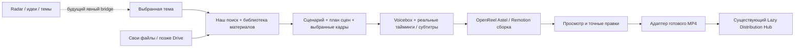

# Astel Video — проверка и следующий план реализации

Проверено 28 октября 2026. База аудита: `integration/voicebox-local-first`, `55f3ab6`. Это аудит, исследование и план; новые источники, модели, серверы, задания Radar и публикации в ходе аудита не запускались. Выполнен один свежий поиск метаданных YouTube. Установленный редактор открыт для чтения сохранённого проекта.

## Решение

Следующее продуктовое звено — **собственная библиотека видеоматериалов и получение выбранных файлов из поиска**. Затем — подготовка нового проекта из сценария и материалов. Сейчас завершена сборка подготовленного Amazon-пакета; подготовка произвольной новой истории ещё требует работы агента.

Сохраняем OpenReel, Voicebox, FFmpeg, локальный Whisper, Remotion и Three.js. Новая монтажная система, второй publisher и набор из двенадцати графических библиотек не нужны для следующего результата.

## Что подтверждено

| Звено | Реальное состояние | Доказательство и граница проверки |
|---|---|---|
| Voicebox RU/EN | Локальный сервис и панели реализованы, профили ранее приняты владельцем | Сейчас health: healthy, MLX, 0.6B, cloud disabled. Новая речь в этом аудите не генерировалась; качество не переоценивалось |
| Тематический YouTube-поиск | Работает выдача метаданных и подборка ссылок | Свежий запрос Amazon: 10 результатов за 1,2 с, без кэша. `skip_download=True`; кнопка сохранения экспортирует TXT ссылок |
| Сборка Amazon v2 | Установлена кнопка, отдельные задачи, прогресс, отмена, MP4 preview/save/import | Хэш установленной cumulative patch и код координатора совпадают с репозиторием. Существует один зарегистрированный пакет |
| Полные MP4 | Два готовых результата | SHA-256 повторно проверены; оба 1080×1920 H.264 + AAC, 62,314667 с. В прежней приёмке измерено 115–153 с на сборку |
| Сохранённый OpenReel-проект | Открывается, содержит результат | Локальный Desktop MCP сейчас прочитал `Astel — сборка Amazon 3D`: 1 дорожка, 1 клип, 311 инструментов |
| Тесты | Локальная часть повторно проверена | 43/43 scoped Python tests пройдены сейчас. 37 Electron/web tests, build/typecheck, native Undo/Redo/save/restart прошли при доставке `55f3ab6`; в этом аудите они целиком не повторялись |
| GitHub backup интеграции | Работа закоммичена локально | GitHub REST для `integration/voicebox-local-first` вернул Branch not found / 404. Эта ветка не имеет upstream; push/PR в этом аудите не выполнялись |
| Lazy Distribution | Существующий Hub отвечает | READ capabilities: live Instagram/Threads маршруты для трёх брендов. Metrics: success 1, pending 1, failed 0, ambiguous 0. Это счётчики Hub, не аудит всех публикаций |
| YouTube | READ-соединение существующего Hub доступно | Прочитан Astel Family. Новый upload, end-to-end autopost и передача MP4 генератора не тестировались |
| Cloud MCP OpenReel | Внешний READ в этом аудите не выполнен успешно | Gateway вернул HTTP 429. Локальный Desktop READ работает после запуска приложения; этот ответ не доказывает поломку редактора |
| ASAP GTA6 | Отдельный существующий проект | Его live capabilities недоступны: tunnel-client давно не виден. Его работоспособность и рендер этим аудитом не подтверждены |

Подробные машиночитаемые результаты: `PROJECT_AUDIT_2026-10-28.json`; предыдущая приёмка сборки: `STORY_ASSEMBLY_VALIDATION_2026-10-28.json`. RAW, озвучка, замороженный checkpoint и publishing не изменялись.

## Основные незакрытые места

1. **Ссылка ещё не стала материалом.** Нет постоянного каталога приобретённых медиа, очереди получения файлов и связки поисковой карточки с импортированным asset. Сохранённая подборка находится в renderer localStorage, а пять минут поискового кэша не заменяют библиотеку.
2. **Следующая тема пока не собирается тем же контрактом.** `story_pilot.py` требует семь авторских сцен; renderer/coordinator разрешают `AstelStoryPilot-3D`; установщик регистрирует конкретный Amazon-пакет. Нужны общая схема истории и регистрация новых подготовленных пакетов.
3. **Нет непрерывного фонового сбора и измеренного рейтинга роста.** Общее число просмотров в поиске не показывает скорость прироста. Нужны сохранённые наблюдения с реальным временем, отсутствующие значения и причины неполной выдачи.
4. **Сборка объединена в один MP4.** Native Undo/Redo работает для импорта, но отдельные титры/сцены/3D редактируются в сохранённом Remotion-исходнике. Полный перенос слоёв в OpenReel — отдельная работа.
5. **До Hub не доехал новый артефакт.** Локальный путь или Drive `/view` не обеспечивает серверу медиабайты. Нужен доставочный адаптер с проверяемым HTTPS URL, точным digest/revision и сроком доступности.
6. **Обратная связь ещё не обучает этот формат автоматически.** Существующий OLEH_STYLE относится к прежнему RAW/challenge workflow. Для истории нужны структурированные правки сцен, источников, титров и фраз; переносить старые правила без адаптера нельзя.

## Обнаруженный параллельный Radar

Проверены текущий чат «Проверить Radar на Mac» и локальный `radar-acceptance` (`ef7d3ae`). В нём уже есть coordinator, task/account leases, checkpoints, deduplication и текстовые evidence/drafts для Threads/Instagram. По README реальный адаптер блокирует медиазапросы и не просматривает видео. Это полезное смежное звено идей/обсуждений, а не реализованный поставщик видеоматериалов для редактора.

В текущем доступном реестре нет `radar_*`. По соседнему чату deployment был выполнен, но приёмка Mac login/операторских команд не завершена; живые Radar-задачи здесь не читались и не создавались. Поэтому нельзя объявлять его ни отсутствующим, ни полностью подключённым.

Повторно используем подходы Radar к ownership, идемпотентности и evidence. Его account locks, сессии и рабочую базу не следует переносить в видеобиблиотеку. Позже можно добавить явную связь `topic/source evidence → video project` через согласованный контракт. Отправлять сообщения другим чатам, расширять права или менять Hub для этого аудита не требовалось.

## Что показал актуальный upstream/deep search

| Компонент | Проверено по первичному источнику | Решение |
|---|---|---|
| OpenReel | Наш pin `c9340465`; текущий main `367d7e9`, один следующий commit, **129 файлов**. В него входят audio extraction, transactional editing, backups, captions и export fixes | Запланировать отдельную проверку обновления и перенос Astel patch; рабочую app не менять во время разработки библиотеки. [Commit и состав](https://github.com/Augani/openreel-video/commit/367d7e90b61b5181f9861b852bb8b9d7a7d2954a) |
| Voicebox | Текущий main совпал с нашим pin `8af7efe6` | Обновление версии само по себе не является найденным способом улучшить голос. Сохранить текущий runtime. [История](https://github.com/jamiepine/voicebox/commit/8af7efe62fab8d33e2a5dfbedabaa45f68a5184f) |
| yt-dlp | Установленная `2026.10.26` совпала с текущим release. Для полного YouTube-пути upstream указывает FFmpeg/FFprobe, EJS и JS runtime; текущая metadata-установка сделана с `--no-deps` | Использовать как компонент собственного адаптера. Для получения файлов нужен отдельный проверенный набор зависимостей; поиск не является download smoke test. [Зависимости](https://github.com/yt-dlp/yt-dlp#dependencies) |
| Wikimedia Commons | Search API + Imageinfo возвращают URL, размеры и расширенные метаданные | Первый новый сетевой адаптер на основе уже проверенного Commons-пилота: автор/источник/license и локальный digest идут вместе с asset. HTML metadata очищать перед показом. [Search](https://www.mediawiki.org/wiki/API:Search), [Imageinfo](https://www.mediawiki.org/wiki/API:Imageinfo) |
| Pexels | API даёт видео и варианты файлов, требует key; default 200 requests/hour, 20 000/month | Дополнительный адаптер после Commons/своей папки; ключ пока не создавался. [Документация](https://www.pexels.com/api/documentation/) |
| YouTube Data API | В текущей документации search bucket — 100 calls/day, 1 unit/call; `videos.list` возвращает statistics | Дополнительный прямой metadata-адаптер для подтверждённых потребностей. 100 тем × несколько запросов уже требуют очереди и квоты. API-поиск не предоставляет разрешение скачивать видео. [Search](https://developers.google.com/youtube/data/reference/rest/v3/search/list), [Videos](https://developers.google.com/youtube/data/reference/rest/v3/videos/list), [API policies](https://developers.google.com/youtube/terms/developer-policies) |
| PySceneDetect | Есть content/adaptive scene detection, для split нужен FFmpeg/mkvmerge; актуальная документация 0.7.1 | Кандидат после работающего получения файла: находить границы кадров. Соответствие сцен смыслу всё равно оценивается отдельно. [Официальная документация](https://www.scenedetect.com/docs/latest/) |
| HyperFrames | Альтернативное авторство видео через HTML/CSS, Apache-2.0; решает задачу рендера | Оставить кандидатом для отдельного A/B. Замена Remotion не закрывает поиск/получение материалов. [Upstream](https://github.com/heygen-com/hyperframes) |
| Qwen3-TTS | Есть Base 0.6B/1.7B для клона и отдельные CustomVoice/VoiceDesign варианты | Позже сравнивать собственный голос на одинаковом тексте и записи. Большая модель не считается доказанным улучшением на M1/16 ГБ. [Модели и контракты](https://github.com/QwenLM/Qwen3-TTS#model-cards) |

Для YouTube сохраняем отдельные роли: найденный референс/сигнал и доступный исходный файл. Первый сетевой путь получения исходников строим на Commons и собственных файлах; доступ к странице и наличие лицензии в описании не должны превращаться в обещание скачать любую ссылку. Условия провайдера и возможность получить bytes проверяются адаптером.

## Целевая схема

## Порядок реализации и критерии готовности

### P0. Наблюдаемость и сохранение текущей базы

Сохранить pin, cumulative patches, approved package и приватные voice bindings. **Первый служебный шаг — сохранить интеграционную ветку на GitHub через проверенный push/PR, без merge в main.** Сейчас новая работа закоммичена только локально; бинарники, исходные записи голоса и приватные bindings должны оставаться вне Git, с отдельным приватным backup. Сам аудит не выполняет push.

Повторить внешний MCP READ после ошибки gateway; установить причину только по данным, не заменять credentials вслепую. Локальная UI-сборка может работать независимо от cloud connector. Upstream-обновление OpenReel проверять отдельно с прежними проектами и Undo/export gates.

### P1. «Найти → получить файл → открыть в редакторе» — следующий конкретный этап

Доработать существующую панель поиска: источники, подборка, очередь получения файлов, карточка готового asset и **«Добавить в проект»**. Сохранять состояние за пределами renderer localStorage.

Начальный состав: существующий YouTube metadata adapter; новый Commons adapter; своя локальная папка. Варианты Pexels/Drive подключаются к тому же контракту позже. Сначала один проверенный путь к bytes, затем остальные провайдеры.

Критерии приёмки:

1. Новая тема возвращает кандидатов; для каждого указан provider и canonical source ID. Совпадения source ID не дублируются.
2. Выбор доступного материала создаёт durable acquisition job. Закрытие OpenReel не останавливает worker на включённом бодрствующем Mac.
3. Файл получен, проверен FFprobe, сохранены автор, URL, условия использования, captured_at и фактический SHA-256. Исходник сохранён неизменным, preview/proxy отдельно.
4. Повторное действие возвращает существующий asset, не скачивает его заново. Один provider failure не удаляет результаты других.
5. Файл появляется в медиа OpenReel; после перезапуска видны прежняя задача и результат. Проверяется смена активного проекта во время импорта.
6. Есть отмена, понятная причина отказа, ограничение диска и восстановление после прерывания. Масштабирование проверяется после этого пути.

### P2. Новая история из сценария и выбранных материалов

Ввести versioned `StoryProject` и фиксированный общий шаблон `StoryShortV1`: произвольные scene IDs, типы footage/photo/title/motion, выбранные source ranges, factual sources, script revision, voice job/audio hash, ASR/caption revision и render recipe version. Регистрация пакета выполняется после проверки всех входов; пакет не исполняет присланный JSX/команды.

Соединить уже работающий Voicebox с подготовкой новой истории: текст → озвучка → реальные длительности → ASR/проверка титров → сцены → сборка. Подмена WAV требует пересчёта таймингов и новой revision. Amazon остаётся неизменным regression fixture.

Приёмка: создать **другую историю**, отличающуюся сценами и количеством материалов, получить 30–60-секундный MP4 через UI без правки Python/TSX/терминала владельцем. До этого произвольная тема не считается поддержанной. Факты и итоговый сценарий проходят редакторскую проверку, автоматический paid LLM не добавляется скрыто.

### P3. Готовый MP4 → review → существующий Hub

Ввести `RenderArtifact`: content ID, revision, sha256, local receipt, source credits и delivery receipt. Delivery adapter обеспечивает проверяемый HTTPS URL медиабайтов на разрешённом host и срок доступа после запланированного времени. По прочитанному Hub candidate contract обязательны asset identity/revision/availability; live capabilities подтверждают маршруты, но не полноценную передачу нового артефакта.

Первое испытание — contract validation/simulation и review, без публикации. Любое изменение MP4 делает старое согласование неприменимым. Не создавать второй scheduler/publisher и не считать статус provider accepted доказательством опубликованного поста.

### P4. Темы пакетами и фоновый сбор

После одного полного пути — topic queue, сначала пять тем; затем партия до ста тем с bounded concurrency, checkpoint, retry/backoff, историей наблюдений и повторным использованием файлов. Интервалы повторных замеров определяются квотами провайдера. Без двух измерений скорость роста остаётся unknown; views/age не выдаются за измеренный тренд. Переиспользование сигнала Radar — отдельный проверенный adapter.

Mac Stage 1 работает при включённой системе. Для непрерывного 24/7 сбора позже выбирается постоянно доступный исполнитель; Windows/Kevin остаётся Stage 2 после приёмки Mac-пути. Уже имеющаяся RAW-worker очередь и Radar account locks сохраняют собственные контракты.

### Отдельная дорожка качества

Voice reference/diction, фразовые окончания и узнаваемость RU/EN проверять короткими контролируемыми A/B, а не новой глобальной скоростью. Затем — монтажная плотность, разнообразие исходников и соответствие кадров сценарию. Native layered handoff, структурированный correction diff/OLEH_STYLE, face/avatar и дополнительные motion libraries добавляются по измеренной потребности после базового пути. Новый voice reference или модель не заменяют текущий принятый профиль автоматически.

## Минимальная техническая основа P1

Собственный локальный Python service/worker, private SQLite catalogue с FTS5, существующие FFmpeg/FFprobe и Electron IPC. FTS5 проверен в доступном Python. UI запрашивает сохранённое состояние; acquisition выполняется отдельным worker. Для вызовов из редактора достаточно typed IPC, публичный HTTP listener не нужен. Схема и фоновые задания проектируются отдельно от production Hub; позднее agent MCP поверх тех же операций.

Предлагаемые сущности: `Topic`, `SearchRun`, `SourceCandidate`, `MetricObservation`, `AcquisitionJob`, `MediaAsset`, `SceneRange`, `StoryProject`, `RenderArtifact`. Метаданные nullable; source ID и content hash решают разные виды дублей. Первый фактический digest вычисляется из полученных bytes, а не подставляется как якобы заранее известный SHA-256.

Для runtime — отдельная venv/зависимости acquisition, без изменения принятого Voicebox. Файлы находятся в управляемой локальной библиотеке; виртуальная Drive-ссылка должна сначала обеспечить читаемые локальные bytes. На Mac сейчас 16 ГБ RAM и около **18,8 GiB свободного диска**: ограничить число одновременных загрузок, размер кэша и свободный резерв до массового сбора. Новые SaaS-подписки для первого Commons/локального пути не требуются; расширенные API выбираются и подключаются явно.

Итог следующей реализации: **по новой теме получить выбранный файл в OpenReel через наш инструмент**. Следующий после неё результат: **собрать из нового сценария новую историю**. Это закрывает фактические разрывы по порядку и сохраняет текущие генератор, голос и публикацию.
