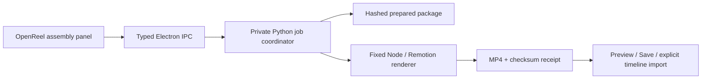

# Local prepared-package assembly in OpenReel Astel

Stage 1 is the Apple Silicon Mac. Windows/Kevin remains Stage 2. This adds a native launch/review/import workflow for the frozen Amazon v2 package; topic research and authoring a new story still need a separate preparation step.

## Owner workflow

1. Open **OpenReel Astel**, then create/open the target video project.
2. Choose **AI Generate → Сборка ролика**.
3. Select **Amazon · озвучка + видео + 3D**, then **Собрать MP4**.
4. Watch progress, or close OpenReel. Reopen the same project and this panel to restore the task.
5. Preview the result. **Сохранить MP4…** opens the native save dialog; **Добавить на таймлайн** appends one video clip with its audio. Undo removes the appended track/clip as one edit. Repeated Add does not duplicate the clip.

The prepared package uses the accepted narration, footage, captions and frame-driven Three.js scenes. It does not regenerate speech or change the quality checkpoint. A new job creates a separate output; input media and earlier renders are never overwritten. The on-timeline MP4 is flattened: per-scene text/3D remains editable in the retained Remotion source, not as OpenReel layers.

## Architecture



The renderer receives package/job locations only from the private coordinator. The renderer UI can submit only a UUID, a prepared-package alias and its project ID. It cannot supply commands, code, arbitrary paths, URLs or composition settings. Source media are checked against SHA-256 before rendering. Installed render source and dependency lock are also checked; setup refuses a different renderer in the same runtime home.

Job states: `queued → rendering → ready | failed | cancelled`. UUID retries are idempotent and conflicting payloads are rejected. A detached worker and inherited file locks preserve execution after editor/IPC exit and prevent overlapping render processes, without relying on reusable PIDs. One render runs at a time. Interrupted jobs are retried on panel recovery; a completed receipt is validated/reused. Reboot recovery restarts unfinished rendering; this is not a frame-level resume or a boot-time scheduler.

Completion validates checksum, size, video dimensions, AAC audio and expected duration using FFprobe. Electron independently validates the fixed output path, real path, size and checksum before returning MP4 bytes. Timeline import verifies the original project before/after decoding and refuses to overwrite concurrent manual edits. Saving uses the existing native streaming file API.

## Local layout

```text
~/.local/share/astel-story-render/
  bin/node, bin/ffprobe        # fixed local executables
  venv/                       # standard-library Python coordinator
  src/video_editor/story_jobs.py
  runtime/                    # copied render source, pinned dependencies/browser
  packages/amazon-3d-9589ee7/   # input manifest, props, public media, SOURCES.md
  jobs/<uuid>/                # state, progress, private log, MP4 and receipt
```

No runtime symlink points into the repository, Codex cache, or Documents. FFprobe still depends on the existing Homebrew FFmpeg dylibs; Python's venv depends on its installed base interpreter. Keep those installed. The copied Node runtime and media do not require a terminal or an AI API key for each build. Voicebox and its private reference recordings are separate; only the previously generated pilot WAV is in this package.

## Reproduce setup/build

Prerequisites: Apple Silicon macOS, Python 3.11+, Homebrew FFmpeg, Node 22+, pnpm, original `/Applications/OpenReel.app`, previously configured local Voicebox RU/EN bindings, and this repository's pinned dependency installs. From the repository root:

```bash
cd remotion
npm ci
npx remotion browser ensure
cd ..
python3 scripts/setup_story_render_mac.py --node /absolute/path/to/node
python3 scripts/install_openreel_voicebox_mac.py \
  --with-story-render --node /absolute/path/to/node --pnpm /absolute/path/to/pnpm
```

Prepared media are intentionally excluded from Git. On another Mac, first provision the package from the retained local snapshot with `scripts/setup_story_render_mac.py --node /absolute/path/to/node --pilot-archive /absolute/path/to/Amazon-v2-9589ee7-local-snapshot.zip`. Its checksum is checked against the frozen checkpoint; only the fixed media/props/source-credit members are read. Keep the installed runtime when building the app; the subsequent installer can reuse this package even when the ignored preparation files are absent.

The application installer deliberately refuses to overwrite an existing `~/Applications/OpenReel Astel.app`. Quit the app and preserve that candidate in a backup folder first. It clones the pinned OpenReel revision, applies the cumulative `integration/story-render/0001-openreel-astel-assembly.patch`, typechecks/builds, preserves original dependency notices and includes upstream MIT. `--built-source` can reuse an inspected build if the full patch reverse-check succeeds. The upstream checkout, OpenCut experiments and production publisher remain separate.

Runtime setup is idempotent for the same code/inputs and refuses installation while a render holds the global lock. Renderer/dependency changes require a separately versioned runtime and explicit migration, rather than silently changing persisted jobs. The native panel currently targets the default runtime home.

## Migration map for this increment

| Component | Decision | Result |
|---|---|---|
| OpenReel editor/media/project/undo | KEEP | Native review and explicit import |
| Voicebox RU/EN + accepted narration | KEEP | No new speech or reference changes |
| Accepted Amazon Remotion/Three.js source | KEEP | Frozen content reused byte-for-byte |
| Agent-only montage command | PORT | Native panel, private jobs, progress, cancel, recovery |
| Separate command-line launch for every build | DEPRECATE LATER | UI path delivered; CLI retained for diagnostics |
| Per-scene OpenReel editing | PORT LATER | Current deliverable is a flattened MP4 |
| General topic → material → authored story | PORT LATER | Preparation still agent-assisted |
| Distribution/production publishing | KEEP SEPARATE | No Hub submission or publishing mutation |

## Next tool/MCP steps

1. Add a reviewed package-registration contract after the discovery/acquisition library exists. Search results alone are not renderable/approved inputs.
2. Connect newly approved Voicebox narration to story timing/captions before registering a new package. Do not swap audio under existing timing.
3. Expose scoped assembly `list/submit/status/cancel` tools only after validating that contract. This increment uses desktop IPC; no new public MCP tools or remote access were added.
4. Add explicit review/handoff to Lazy Distribution as a later stage. Rendering must never imply publishing approval.
5. Evaluate layered scene import or OpenReel-native Motion Creator output separately from this working MP4 handoff.

Verification evidence is in `STORY_ASSEMBLY_VALIDATION_2026-10-28.json`. Existing Amazon v1, the frozen v2 ZIP/checkpoint, original OpenReel and publishing configuration are preserved.
